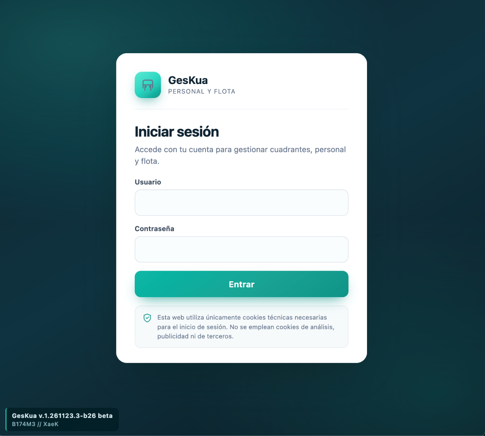
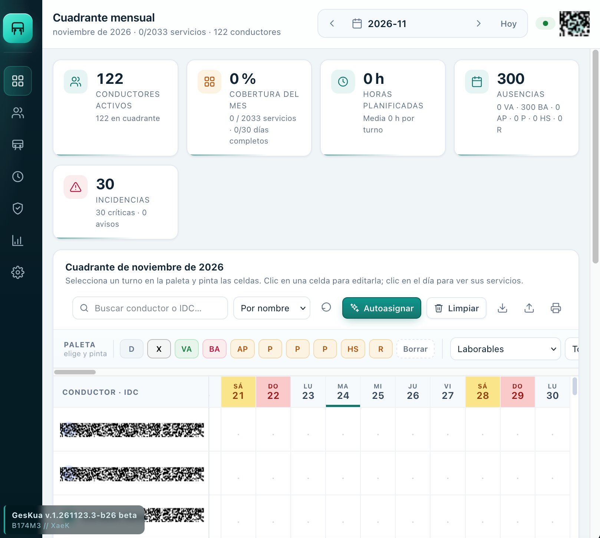
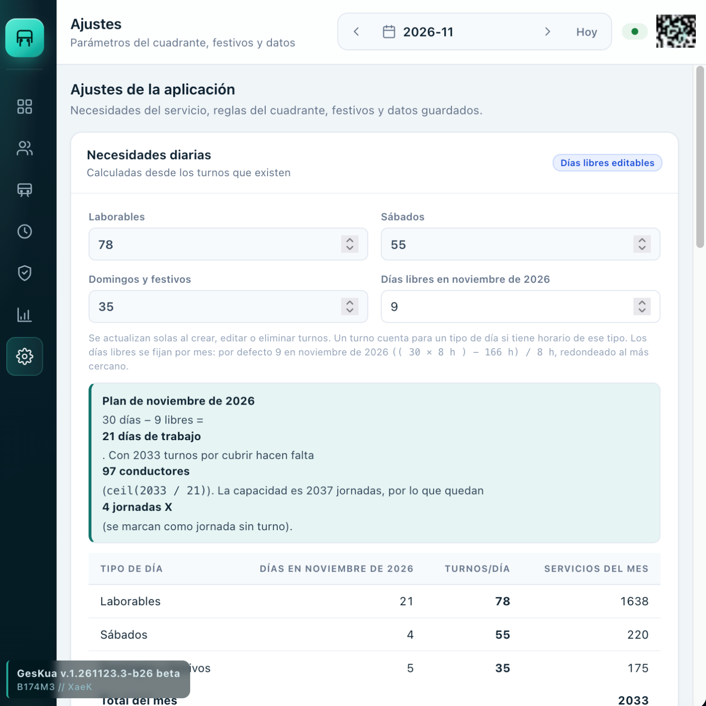
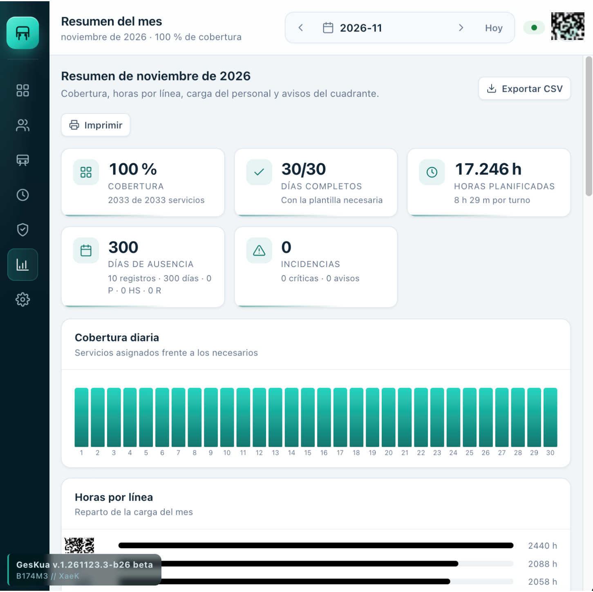

Aplicación web para planificar el trabajo de una plantilla de conductores: cuadrante
mensual, altas y bajas de personal, ausencias, flota, turnos y métricas de
cobertura.


El repositorio se entrega sin datos de negocio: `data/seed.json` es una plantilla
vacía y `data/db.json` y `data/users.json` se generan automáticamente en el
primer arranque. La primera cuenta es `admin`/`admin` y debe cambiarse antes de
usar la aplicación.


## Instrucciones de instalación

1. Descarga o clona el repositorio.
2. Sube los archivos a un servidor con **PHP 8.1+**. No requiere base de datos.
3. Coloca todos los archivos en una carpeta, por ejemplo `/var/www/html/geskua/`.
4. Da permisos de escritura a la carpeta: la aplicación necesita crear los `.json` de datos y los logs.
   ```bash
   sudo chown -R www-data:www-data /var/www/html/geskua
   ```
5. Accede a `'ip-host'/geskua/index.php` en tu navegador.
6. Inicia sesión con las credenciales predeterminadas:
   - Usuario: `admin` — Contraseña: `admin`
Se le pedira crear nuevo SuperAdministrador y nueva contraseña.

OPCIONAL. Si es necesario, ajusta propietario y permisos:

   ```sh
   sudo chown -R www-data:www-data /var/www/html/geskua
   sudo find /var/www/html/geskua -type d -exec chmod 755 {} \;
   sudo find /var/www/html/geskua -type f -exec chmod 644 {} \;
   sudo chmod -R 775 /var/www/html/geskua/data
   ```


## Publicar en un servidor (PHP + Apache)

No hace falta Composer, Node, base de datos ni procesos en segundo plano: solo
PHP 8.1 o superior con `json` y `session`. `mbstring` es recomendable; si no está
instalada, la aplicación usa `iconv`/PCRE como respaldo (`lib/Compat.php`) y
funciona igual.


   La carpeta incluye `.htaccess` que bloquean el listado de directorios, el
   acceso a `data/` y `lib/`, los JSON y archivos ocultos, y la ejecución de
   PHP dentro de `assets/`. Apache debe permitirlos:

   ```sh
   sudo a2enmod headers rewrite
   ```

   Además, `/var/www/html` necesita `AllowOverride All` (o al menos
   `AllowOverride Limit Options FileInfo`) en `/etc/apache2/apache2.conf`. Si
   prefieres no usar `.htaccess`, aplica este bloque en el VirtualHost:

   ```apache
   <Directory /var/www/html/geskua>
       Options -Indexes
       AllowOverride All
       Require all granted
   </Directory>
   <Directory /var/www/html/geskua/data>
       Require all denied
   </Directory>
   <Directory /var/www/html/geskua/lib>
       Require all denied
   </Directory>
   ```


## Instalación como aplicación (PWA)

La carpeta incluye `manifest.json` y los iconos del logo:

| Archivo | Uso |
| --- | --- |
| `assets/icon-192.png` | Icono de la app y «apple-touch-icon». |
| `assets/icon-512.png` | Icono grande para el instalador. |
| `assets/icon-maskable-512.png` | Variante «maskable» para Android. |

El manifest se enlaza desde `login.php` e `index.php` con rutas relativas, así
que funciona igual en `/geskua/`, en `/app/geskua/` o en la raíz. No hace falta
service worker para que aparezca la opción de instalación en Chrome/Edge.

El `.htaccess` excluye `manifest.json` del bloqueo general de JSON y lo sirve
como `application/manifest+json`. Si no usas `.htaccess`, añade esto al
VirtualHost (ajustando la ruta si hace falta):

```apache
<Location /geskua/manifest.json>
    ForceType application/manifest+json
</Location>
```


## Acceso y tipos de usuario

La aplicación pide iniciar sesión. La primera vez se crea la cuenta
**admin / admin**; al entrar, la aplicación obliga a cambiar el nombre de
usuario y la contraseña antes de permitir cualquier otra operación.

Hay cuatro roles:

- **Superadministrador** (`admin`): acceso completo, incluida la sección
  **Usuarios** para crear, editar y eliminar cuentas. También puede subir el
  Excel del cuadrante.
- **Administrador** (`editor`): acceso al cuadrante, personal, flota, turnos,
  resumen y ajustes. Ve la sección **Usuarios** únicamente para desbloquear
  cuentas: no puede crear, editar ni eliminar usuarios. También puede subir el
  Excel del cuadrante y cambiar su propia contraseña desde el menú de usuario de
  la barra superior.
- **Colaborador** (`colaborador`): puede preparar **Personal**, **Flota**,
  **Turnos** y ausencias, y autoasignar un mes mientras todavía no tenga turnos
  asignados. En cuanto el mes tiene un cuadrante generado queda en solo lectura
  para ese mes: no puede editarlo, limpiarlo ni volver a autoasignarlo. Puede
  cambiar a otro mes vacío y repetir el proceso. Accede a **Ajustes** solo para
  consultar: no puede cambiar reglas, festivos ni restaurar datos. No ve la
  sección **Usuarios** y no puede importar el cuadrante, aunque sí descargarlo.
- **Lector** (`lector`): solo consulta cuadrante, personal, flota, turnos,
  resumen y ajustes. No ve botones de edición ni de subida de Excel, no puede
  modificar ningún dato (ni siquiera llamando a la API directamente) y
  únicamente puede cambiar su propia contraseña desde el menú de usuario. Puede
  descargar los Excel e imprimir, pero no importarlos.

Las cuentas se guardan en `data/users.json` con contraseñas cifradas mediante
`password_hash`.

**Protección contra fuerza bruta:** tres intentos fallidos consecutivos de
contraseña bloquean esa cuenta. La API responde entonces con estado `423` y el
mensaje «Cuenta bloqueada tras 3 intentos fallidos. Contacta con un administrador
para desbloquearla.». Un acceso correcto reinicia el contador. Solo un
**Superadministrador** o un **Administrador** puede desbloquearla desde la tabla
**Usuarios** (botón «Desbloquear»); Colaborador y Lector no pueden hacerlo, ni
siquiera llamando a la API directamente. El desbloqueo reinicia el contador de
intentos. Los intentos fallidos de usuarios inexistentes o inactivos no cuentan.


## Vistas

- **Cuadrante**: rejilla mensual con una fila por conductor y una columna por día.
  Cada celda muestra el código de turno o un estado (`D` descanso, `VA`
  vacaciones, `BA` baja, `AP` asuntos propios, `P` permiso por ingreso/cuidados/
  fallecimiento, `HS` horas sindicales y `R` horas registro). Vacaciones se pinta
  en verde, baja en rojo y el resto de ausencias con el color de asuntos propios.
  Solo aparecen los trabajadores
  activos cuyo `role` es `Conductor` o `Conductora`; los inactivos y otros roles
  (jefe de servicio, mecánico, inspector…) siguen en **Personal**, pero no en el
  cuadrante. Los domingos y festivos se distinguen visualmente. La cabecera
  resume cobertura, horas y avisos.
- **Personal**: dos pestañas. **Fichas y carga** muestra la búsqueda, la ficha
  de cada conductor (nombre, categoría, estado, grupo, compañero, combustibles
  autorizados, tope de metros y autorización de articulados), las altas, las
  ediciones, las bajas y las ausencias del mes, además de los botones **Excel**
  (descargar) y **Subir Excel**. Los tipos de ausencia son `VA` vacaciones, `BA`
   baja médica, `AP` asuntos propios, `P` para permiso por ingreso, cuidados o
   fallecimiento (tres tipos distintos con la misma marca visual), `HS` horas
   sindicales y `R` horas registro. **Parejas y grupos** permite elegir el grupo A/B y
  el compañero fijo de cada trabajador; los cambios se guardan al seleccionar la
  opción y la pareja queda reflejada en ambas fichas.
- **Flota**: catálogo de modelos de autobús y tarjetas de vehículos con
  matrícula, tipo del catálogo, foto y estado. Un botón alterna entre
  disponible y taller. El mapa de servicios indica qué bus lleva cada asignación.
  Los botones **Excel vehículos** y **Subir Excel** exportan e importan solo los
  vehículos, nunca los modelos ni las variantes del catálogo.
- **Turnos**: catálogo de turnos por línea con horarios para laborable, sábado
  y domingo/festivo, horas calculadas y variantes, además de las restricciones
  editables de combustible y tamaño por línea. Se pueden crear, editar y
  eliminar turnos (los códigos 81–83 solo existen en sábado). Los botones
  **Excel turnos** y **Subir Excel** exportan e importan solo los turnos, nunca los
  tipos de línea.
- **Resumen**: indicadores del mes, cobertura diaria, horas por línea, conductores
  con mayor carga, incidencias, ausencias y necesidades.
- **Ajustes**: necesidades diarias calculadas automáticamente desde el catálogo
  de turnos (solo lectura), reglas de autoasignación, festivos, resumen de datos,
  exportación, impresión y restablecimiento. Los lectores y colaboradores solo
  pueden consultarlo; el colaborador puede descargar e imprimir desde aquí.
- **Usuarios**: el superadministrador ve cuentas, roles, alta, edición,
  contraseña y baja; el administrador ve la tabla solo para desbloquear cuentas.
  Colaborador y lector no ven esta sección.
- **Menú de usuario**: cambiar la contraseña propia y cerrar sesión.

## Uso del cuadrante

- **Pintar**: elige un chip de la paleta (turno o estado) y haz clic en una celda.
  Mantén pulsado y arrastra para pintar varias celdas seguidas. «Borrar» deja la
  celda libre y «Salir» desactiva el modo pintura.
- **Inspector**: al hacer clic en una celda sin paleta activa se abre un panel con
  el detalle del conductor, su carga del mes y las opciones de la celda.
- **Panel del día**: pulsa la cabecera de un día para ver los servicios asignados,
  la cobertura y los huecos.
- **Guardado**: cada cambio se envía en segundo plano por lotes. El indicador de la
  barra superior muestra «Guardando…» y vuelve a «Guardado» al confirmar.
- **Deshacer**: botón de la barra o `⌘Z` / `Ctrl+Z` deshace el último cambio.
- **Autoasignar**: rellena el mes respetando ausencias, descanso mínimo (con
  descansos reducidos limitados), el límite de 5 días consecutivos (6 solo con
  48 h de descanso propio y no reutilizable), repartiendo la carga entre la
  plantilla. Solo asigna buses
  autorizados y válidos para la línea, prioriza el relevo entre turnos impar y
  par, mantiene juntas a las parejas fijas y reserva el grupo A para mañana y el B
  para tarde. Al terminar muestra servicios generados, buses reasignados, parejas
  juntas, cambios de grupo de emergencia y descubiertos. El resultado se puede
  revisar y ajustar a mano. El colaborador solo puede autoasignar mientras el mes
  no tenga turnos; una vez generado, ese mes queda bloqueado para su cuenta.
- **Limpiar**: borra los turnos y descansos del mes, pero conserva las ausencias
  (`VA`, `BA`, `AP`, `P`, `HS` y `R`), la plantilla, la flota, los turnos y los festivos.
  El colaborador no puede usarlo: no modifica ajustes ni un mes ya asignado.
- **Exportar/Imprimir**: descarga el cuadrante en un `.xls` real (mismo formato que
  Personal, Flota y Turnos) o abre la vista de impresión. La impresión sale en
  vertical, en una única hoja A3 (si la impresora no dispone de A3 se adapta a A4),
  con márgenes de 2 mm y la firma visible. El Excel lleva una fila
  superior con el tipo de día (`DO`, `LU`, `MA`, `MI`, `JU`, `VI`, `SA`, `FE` para
  festivos), debajo solo el número de día, y las columnas finales `Horas`,
  `Libres` (días marcados como `D`, sin contar vacaciones, bajas ni asuntos
  propios) y `Turnos`. Está disponible para todos los roles con acceso al
  cuadrante.
- **Importar Excel**: el botón de subida junto a **Exportar** aparece solo para
  **Superadministrador** y **Administrador**. Lee el Excel generado por la propia
  aplicación (o un CSV con la misma cabecera), localiza la columna `IDC`,
  identifica los días por su número y aplica los cambios al mes seleccionado.
  Una celda vacía borra esa asignación; las columnas `Horas`, `Libres` y `Turnos`
  se ignoran porque se recalculan. Los conductores se resuelven por `IDC` o por
  nombre, y las celdas con turnos no válidos para ese tipo de día se rechazan con
  su motivo. Un `lector` o un `colaborador` recibe HTTP `403` con el mensaje
  «Solo los administradores pueden importar el cuadrante.».
- **Mes**: los botones laterales y el selector de la barra cambian de mes. El mes
  activo se recuerda en `settings.currentMonth` mientras la sesión sigue abierta,
  de modo que se conserva al pasar de una vista a otra. Al cerrar sesión o al
  iniciar otra (aunque sea otro usuario) se reinicia automáticamente al mes
  actual, sin arrastrar la última selección.

## Necesidades diarias

Las necesidades diarias son de solo lectura (solo se editan los días libres por
mes). `Store::calculateNeeds()` recorre
`db.shifts` y cuenta cuántos turnos tienen variante horaria para cada tipo:

- `lv`: turnos con horario de laborable.
- `sab`: turnos con horario de sábado.
- `dom`: turnos con horario de domingo/festivo.

El cálculo se ejecuta al cargar el estado y de nuevo justo después de crear,
editar o eliminar un turno. Así, dar de alta un turno suma una necesidad y
borrarlo la resta, sin campos manuales que puedan quedar desactualizados.
Solo se excluyen los turnos **archivados** (`deepInactive`): un turno marcado
como inactivo por no aparecer en la última importación sigue contando mientras
no se archive, porque continúa visible y puede tener asignaciones en cuadrantes
anteriores. Ajustes muestra también los días de cada tipo en el mes y el total
de servicios resultante.

### Días libres y jornadas `X`

A partir del total de servicios del mes se calcula cuántos conductores hacen
falta. El número de **días libres** se obtiene de la jornada anual de 166 horas:

```
días libres = redondear(((días del mes × 8 h) − 166 h) / 8 h)
```

Por ejemplo, en un mes de 30 días son 9 libres (`(240 − 166) / 8 = 9,25`).
Ese valor se puede fijar **por mes** en Ajustes → «Necesidades diarias»; si no
hay valor guardado para ese mes se usa el cálculo anterior. Cuando un conductor
está de baja o de vacaciones solo parte del mes, sus `D` se prorratean sobre los
días en los que realmente puede trabajar:

```
D proporcionales = redondear((libres del mes / días del mes) × días disponibles)
```

Por ejemplo, con 9 libres en un mes de 30 y 10 días de baja, el conductor tiene
20 días útiles y recibe 6 `D` (`9 / 30 × 20 = 6`). Quien está ausente todo el mes
no recibe ningún `D`. El prorrateo se aplica solo a conductores con ausencias;
quienes están disponibles todo el mes conservan el objetivo general. Con el
total del mes se deriva:

```
días de trabajo   = días del mes − días libres
conductores       = ceil(turnos totales del mes / días de trabajo)
capacidad         = días de trabajo × conductores
X                 = capacidad − turnos totales del mes
```

`X` es una **jornada sin turno**: cuenta como día trabajado para las rachas y
aparece en la paleta, en el cuadrante y en Excel con la letra `X`, en negro, pero
no cubre servicio, no suma horas y **no tiene horario**. Por eso no interviene en
el cálculo de descansos de 12 horas ni consume cupo de descansos reducidos: no se
inventa una jornada de mañana ni de tarde. Para medir descansos se omiten las
celdas `X` y se usan los turnos reales más próximos.

Al autoasignar, **ningún conductor recibe menos de los días libres calculados
menos uno**. El objetivo es que todos tengan exactamente los días libres del mes:
se les va dando `D` hasta alcanzar esa cifra y el día sobrante se convierte en
`X`, con un máximo de un día más y solo en casos imposibles. Las `X` del plan son
**obligatorias**: al terminar el reparto quedan exactamente las calculadas, ni
una más ni una menos, y se asignan a quienes tienen libres de sobra, priorizando
a quien más se pasa del objetivo y los días con rachas más cortas. Nunca se usan
para romper el descanso de 48 h de un bloque de 6 días: si hace falta, una `X`
contigua al descanso se devuelve a `D` y se compensa con otra `D` en una posición
segura. **Nunca se dan más de tres `D` seguidos**: en cuanto un conductor lleva
tres, el cuarto día se le fuerza como jornada (turno si hay, `X` si no) y se
corrige cualquier cesión que pudiera dejarle cuatro. Si la aritmética del mes
obliga a repartir algún descanso extra, se permite como máximo **un día más**
sobre el calculado (nunca 12 cuando el objetivo es 10); nunca se supera ese
margen. El toast de «Autoasignar» indica cuántas jornadas virtuales se han
generado.

## Días consecutivos

La regla se aplica tanto al **Autoasignar** como al asignar turnos a mano (paleta
y selector de conductores) y a los avisos del Resumen:

- **Regla general**: como máximo 5 días de trabajo seguidos (valor por defecto).
- **Excepción**: se pueden forzar 6 días consecutivos (valor por defecto) solo si
  ese bloque dispone, antes o después, de un descanso continuo de **48 horas**
  (valor por defecto) que no se use también para otro bloque. El cálculo usa los
  horarios reales: media jornada cuenta, como en el ejemplo de trabajar el
  viernes por la mañana, descansar desde la tarde del viernes, todo el sábado y
  la mañana del domingo, y volver el domingo por la tarde.
- Un mismo descanso no sirve para dos bloques: para «6 días + descanso + 6 días»
  hace falta un segundo descanso propio. El motor reserva las jornadas de
  descanso que usa la excepción para que no se reasignen a ese conductor.

Los tres valores son **editables** en Ajustes → «Reglas del cuadrante», para
adaptarlos si cambia la ley:

- `Máximo de días seguidos`: límite general (5 por defecto).
- `Días seguidos con excepción`: días permitidos con descanso (6 por defecto).
  Poner `0`, o un valor que no supere el máximo general, desactiva la excepción.
- `Descanso continuo para la excepción (h)`: horas exigidas (48 por defecto).

Los cambios afectan a la autoasignación, a la asignación manual y a los avisos.
Los textos informativos de Ajustes muestran siempre los valores configurados.

### Continuidad entre meses

Al generar o asignar el mes siguiente se miran los últimos días del mes anterior:

- La racha de días trabajados continúa: si alguien trabajó los últimos 5 días,
  el día 1 solo puede trabajar si ese bloque de 6 dispone de las 48 h propias
  (antes o después); si ya tenía 6, el día 1 debe ser descanso.
- El descanso mínimo entre turnos se mide desde la hora de fin del último
  servicio del mes anterior hasta la hora de inicio del primero del mes nuevo.
  El cupo de descansos reducidos también continúa: se cuentan los del mes
  anterior que no hayan quedado reiniciados por un descanso semanal.
- Un descanso que ya justificó un bloque de excepción en el mes anterior no se
  puede reutilizar para otro bloque del mes nuevo.

Esto se aplica igualmente al asignar a mano y a los avisos del Resumen.

### Descansos diarios reducidos

Además del descanso diario normal de **12 horas** (editable en Ajustes), se
permiten descansos más cortos con estas reglas:

- El descanso reducido mínimo es de **9 horas** por defecto. Por debajo de ese
  valor no se puede asignar el turno.
- Se pueden tomar como máximo **3** descansos reducidos (valor por defecto)
  entre el final de un descanso semanal y el inicio del siguiente. El umbral de
  descanso semanal es el mismo de Ajustes (`Descanso continuo para la
  excepción`, 48 horas por defecto).
- **No se mide por semana natural**: el contador se reinicia con el descanso
  semanal, no con el lunes. Los descansos reducidos pueden ser días seguidos o
  días alternos.
- Cualquier descanso por debajo del mínimo normal consume cupo, incluidos los
  descansos de 11 a menos de 12 horas. Las horas que faltan hasta las 12 no
  tienen que recuperarse más adelante.
- Con `0` en `Máximo de descansos reducidos` la excepción queda desactivada y
  solo se admiten descansos de 12 horas o más.

Los valores de 9 horas y 3 descansos son **editables** en Ajustes → «Reglas del
cuadrante». La regla la aplican la autoasignación, la asignación manual (la API
rechaza el cambio) y los avisos del Resumen, también al pasar de un mes a otro.

## Catálogo de vehículos

En Flota puedes crear **modelos** con marca, modelo y descripción. Dentro de
cada modelo se añaden **variantes** (submodelos) con tamaño y combustible, por
ejemplo:

```text
Mercedes-Benz Citaro
  9 m  · Gasoil
  12 m · Gasoil
  12 m · Eléctrico
  15 m · GNC (gas)
```

Al crear o editar un vehículo se eligen en cascada la **marca**, el **modelo** y
la **variante** (tamaño y combustible) entre las dadas de alta. El tipo queda
guardado en `vehicle.typeId`, con un identificador estable (`vts_…`). Si se
elimina una variante o un modelo, los vehículos que lo usaban siguen en la
flota pero quedan sin tipo asignado.

Cada ficha admite una **foto** (JPG, PNG o WebP). El navegador la reduce antes
de enviarla y se guarda como data URL en `vehicle.photo`, sin crear archivos
nuevos ni depender de subidas externas. El servidor rechaza otros formatos e
imágenes demasiado grandes.

## Autorizaciones y restricciones

Todos estos campos se editan desde la interfaz y se guardan en `db.json`:

- **Personal**: en cada ficha se marcan uno o varios combustibles
  (`authorizedFuels`) y un tope de metros (`maxVehicleSize`) para vehículos
  rígidos. La marca y el modelo no influyen. Si un conductor puede conducir un
  15 m, también puede conducir un 9 o un 12 m, pero solo con los combustibles
  marcados: autorizar gasoil no autoriza eléctrico ni GNC.
  Los **articulados** (`allowsArticulated`) se autorizan por separado: el tope
  de metros no los incluye, y aun autorizados necesitan el combustible marcado.
- **Turnos → Restricciones por línea**: cada línea puede admitir todos los
  combustibles, solo una lista (`fuelMode: "only"`) o prohibir una lista
  (`fuelMode: "deny"`). Lo mismo aplica al tamaño: cualquiera, solo varios
  tamaños concretos (`sizeMode: "only"`) o hasta un máximo
  (`sizeMode: "max"`). Se pueden **crear y eliminar líneas** desde este panel.
  El código debe empezar por `L` (línea normal), `C` (circular) o `P`
  (periférica) y contener solo letras y números; no se puede borrar una línea
  que todavía usen turnos o variantes. Las líneas se muestran en ese orden
  (`L`, luego `C`, luego `P`) y la tabla de turnos se agrupa en esos tres
  bloques, ordenando dentro de cada uno por número de turno.
  Cada fila de la tabla tiene su botón **Editar** y **Eliminar** turno; este
  último también sigue disponible dentro del modal de edición.

Los vehículos sin tipo de catálogo no se bloquean, para no afectar a la flota
antigua. Los tamaños se conservan aunque todavía no exista una variante con
esa medida (por ejemplo 10 m): si se crea más adelante, la autorización ya está
preparada. Al borrar un combustible del catálogo, este se quita también de las
fichas de personal y de las líneas.

## Parejas fijas y grupos A/B

En **Personal → Parejas y grupos** se asigna a cada trabajador un grupo (`A` o
`B`, o ninguno) y un compañero fijo. Los datos se guardan en cada ficha como
`driver.group` y `driver.partnerId`. La acción `saveDriverPairing` mantiene la
pareja simétrica: si se elige a otro compañero, se deshacen los vínculos
anteriores de ambos. Al guardar una pareja con grupo definido, el compañero
queda automáticamente en el grupo opuesto: si Paco es A, Pedro pasa a B, y al
revés. Las parejas ya guardadas se ajustan solas al cargar los datos, así que
basta con poner el grupo a uno de los dos. Para dejar a alguien sin grupo hay
que quitar primero su compañero fijo.

Si un conductor se queda sin pareja porque su compañero se ha dado de baja, ya
sea por un Excel o por un borrado manual, **conserva su grupo A/B pero se queda
sin compañero asignado**. El vínculo roto se recuerda en `partnerPendingId` y
`partnerBrokenAt`. Si el compañero reaparece antes de los 40 días acordados, la
pareja se restaura automáticamente y el que vuelve toma el grupo opuesto. Si
reaparece pasados esos 40 días, ya no se restaura: el antiguo compañero quedó
archivado. Un Excel nunca reasigna parejas por sí mismo; se gestionan siempre
desde la interfaz.

El grupo **A** se reserva para los turnos impares (mañana) y el **B** para los
pares (tarde). `autoasignar` intenta colocar juntos a cada par en su turno
preferido. Si el compañero está de baja, ya tiene otro servicio ese día o no
tiene un bus válido, se busca otro conductor del mismo grupo antes que romper la
pareja. Solo en una segunda pasada, cuando todavía queden servicios sin cubrir,
se permite saltar a un conductor del otro grupo; esos casos se cuentan en
`stats.crossGroup` y se avisan en el resumen final.

Si ningún conductor tiene grupo, la preferencia se ignora para no alterar datos
antiguos. Las parejas tampoco se fuerzan cuando no hay bus apto para ambos: la
validación de flota y autorizaciones sigue teniendo prioridad.

## Ciclo Excel de inactividad y archivo

Personal, Flota y Turnos tienen cada uno su propio par de botones: **Excel** para
descargar el estado actual y **Subir Excel** para reemplazarlo. Los tres formatos
son independientes y se exportan por separado:

- **Personal** (`personal-YYYY-MM-DD.xls`): IDC, nombre, rol, activo, teléfono,
  carnet, antigüedad, notas, combustibles autorizados, tope de metros,
  articulados, grupo y compañero.
- **Flota** (`flota-YYYY-MM-DD.xls`): solo vehículos (Bus, matrícula, modelo,
  tipo, id de variante, estado, km, antigüedad y notas). No incluye modelos ni
  variantes del catálogo.
- **Turnos** (`turnos-YYYY-MM-DD.xls`): solo turnos (código, turno, línea,
  servicio, bus y horarios de laborable, sábado y domingo). No incluye tipos de
  línea ni sus restricciones.

Los archivos son `.xls` **binarios auténticos (BIFF8/OLE2)**: los genera el
navegador con `assets/xlsx.full.min.js`, un archivo estático más. No hace falta
`php-zip`, Composer ni instalar nada en la Raspberry, y Excel no muestra el aviso
de formato/extensión. Todas las celdas se escriben como texto para que Excel no
convierta matrículas, códigos ni fechas. El importador acepta `.xls`, `.xlsx` y
también un CSV clásico como respaldo. El importador
tolera las autonomías habituales de Excel: mayúsculas (`Taller`, `TALLER`),
espacios, acentos y alias (`en reparación`, `averiado`, `RESERVA`) en **Estado**,
números con separador de miles (`12.345`) en **Km**, y comillas o comas como
delimitador en el CSV. La subida no sustituye la base de datos: compara las filas
con lo que ya existe y aplica este ciclo:

1. **La columna Activo manda**: `0` deja la ficha inactiva (`active: false`,
   `inactiveFrom` con la fecha actual) y `1` la reactiva (`active: true`, sin
   `inactiveFrom`). Si la columna no viene o no es reconocible, se mantiene el
   estado que la entidad tenía antes de desaparecer del Excel.
2. **Falta en el Excel**: es una ausencia del archivo, distinta de estar inactivo.
   Se anota en `missingSince` con la fecha actual y, si estaba activa, pasa a
   inactiva ese mismo día. En los conductores se rompe la pareja, conservando
   grupo A/B y `partnerBrokenAt` por si vuelve.
3. **Sigue sin aparecer 40 días o más**: solo entonces pasa a **inactivo profundo**
   (`deepInactive: true`). El plazo cuenta desde `missingSince`, no desde
   `inactiveFrom`, así que una baja comunicada por la columna `Activo` no archiva
   nada aunque pasen los 40 días.
4. **Vuelve a aparecer**: recupera el estado que tenía antes de desaparecer,
   guardado en `stateBeforeAbsence`, salvo que la columna `Activo` indique otra
   cosa. Si la ausencia duró menos de 40 días no llegó a archivarse y también
   recupera ese estado. Un archivado puede reaparecer: deja de estarlo y vuelve a
   los listados. En los conductores, si su pareja se rompió y aún no pasaron 40
   días, la pareja se restaura sola.

Los archivados se conservan en `db.json` (no se borran físicamente), pero quedan
fuera de los listados de Personal, Flota y Turnos, de los KPIs, de la
autoasignación y de cualquier otra vista. La única excepción es el **cuadrante**:
un conductor archivado sigue viéndose, marcado como «archivado», en los meses en
los que tiene asignaciones, y los códigos de turnos archivados siguen
apareciendo en el panel del día de esos meses. Así se puede consultar el
histórico sin que lo archivado estorbe en la operación diaria.

## Validación conjunta al asignar

Tanto al pintar una celda a mano como al usar **Autoasignar**, la aplicación
comprueba el conductor, la línea y el bus a la vez. La fuente de verdad está en
el servidor (`Store::vehicleContext()` y `Store::chooseServiceVehicle()`); el
cliente aplica la misma lógica para dar una respuesta inmediata, pero el servidor
vuelve a validar cada lote antes de guardarlo.

Para cada servicio se elige el bus previsto en el turno si cumple todas las
reglas; si no, se busca automáticamente otro que:

- esté en la flota y no en taller;
- esté autorizado para ese conductor (combustible, tamaño y articulados);
- cumpla las restricciones de combustible y tamaño de la línea;
- no esté ocupado en otro servicio solapado, siempre que haya alternativa.

Si no existe esa alternativa, la asignación se rechaza con un motivo concreto,
por ejemplo «El bus 3242 está en taller y no hay alternativa disponible» o «El
conductor no está autorizado para el bus 3242 y no hay alternativa». Nunca se
fuerza una asignación inválida.

El bus elegido se guarda por servicio en `vehicleAssignments`:

```
db.vehicleAssignments["2026-11"]["14|2026-11-03"] = "102"
```

Así, el inspector, el panel del día, el mapa de la vista Flota y las ediciones
posteriores muestran y respetan el bus real, aunque no sea el previsto en el
turno. Al vaciar un mes también se borra ese mapa.

### Relevo entre turnos

Los turnos impares son de mañana y los pares de tarde: el turno 2 releva al 1, el
4 al 3, y así sucesivamente. La tarde continúa con el bus del mañana **solo si
empieza cuando el turno anterior ya ha terminado**; si comienza antes del relevo,
arranca un servicio nuevo con otro bus. También puede haber tardes que no relevan
a nadie y mañanas sin relevo. Para decidirlo se comparan los horarios de la
variante del día (`lv`, `sab` o `dom`) y se busca qué bus llevó el turno impar ese
mismo día. La ocupación de buses se trata como preferencia, no como bloqueo,
porque el propio Excel ya reutiliza buses en servicios solapados.

`saveAssignments` devuelve `saved`, `rejected` (con el motivo de cada rechazo),
`reassigned` (bus anterior y nuevo) y el mapa `vehicleAssignments` resultante.
`autoAssign` devuelve el estado completo y un resumen `stats` con `generated`,
`reassigned`, `uncovered`, `paired` y `crossGroup`.

## Reglas de autoasignación

`Store::autoAssign()` solo trabaja con conductores activos (`active`) cuyo `role`
es `Conductor` o `Conductora`. El resto del personal no entra en el reparto.

Recorre los días del mes y, para cada uno:

1. Calcula el tipo de día (`lv`, `sab`, `dom`) a partir del calendario y los
   festivos, y toma las necesidades calculadas desde los turnos: uno por cada
   turno que tenga variante horaria de ese tipo.
2. Descarta a los conductores con ausencia ese día, con `maxConsecutive` días
   seguidos trabajados o sin el descanso mínimo (`minRest`) entre el final del
   turno anterior y el inicio del nuevo.
3. Recorre las parejas de turnos `(1,2)`, `(3,4)`… y cubre antes el impar, para
   que el par pueda heredar su bus cuando no solapen. Dentro de cada pareja
   intenta primero una pareja fija de conductores: A en el impar y B en el par,
   validando ambos buses a la vez antes de confirmar ninguno.
4. Ordena al resto de conductores por menor carga, menor racha y un desempate
   pseudoaleatorio estable por mes. Prefiere el grupo A para impares y el B para
   pares; los conductores sin grupo entran después. Descarta de antemano a quien
   no puede conducir ningún bus válido para las líneas del día.
5. Valida cada servicio con las reglas descritas en **Validación conjunta al
   asignar** y guarda el bus elegido en `vehicleAssignments`. Solo si quedan
   huecos se hace una segunda pasada permitiendo cambiar de grupo; esos cambios
   se cuentan en `stats.crossGroup`. Un servicio sin bus apto queda descubierto y
   se cuenta en `stats.uncovered`, mientras que `stats.paired` cuenta los turnos
   cubiertos por parejas fijas.
6. Marca `D` hasta completar los días libres objetivo del mes (con un mínimo de
   `libres − 1`) y `X` al resto de jornadas sin turno. Si ya lleva tres `D`
   consecutivos, el cuarto día se fuerza como `X`; el tipo de ausencia (`VA`,
   `BA`, `AP`, `PI`/`PC`/`PF` —todos visibles como `P`—, `HS` o `HR` (visible
   como `R`)) se escribe cuando corresponde.
7. Reparte de forma uniforme los días libres: si alguien se pasó del objetivo,
   convierte los `D` sobrantes en `X` allí donde no aparezca una racha prohibida
   ni se rompa el descanso de 48 h de un bloque de excepción. Cualquier cesión
   posterior comprueba que ni quien entrega ni quien recibe el turno supera tres
   `D` seguidos. Después de cubrir los huecos que queden, se revisa el total de
   `X`: si faltan, se añaden a conductores con libres de sobra; si sobran, se
   devuelven a `D` solo en posiciones seguras. Así el mes termina con las `X`
   exactas del plan y sin rachas de cuatro libres.

La semilla pseudoaleatoria se deriva del mes, de modo que repetir la
autoasignación sobre el mismo estado produce el mismo resultado.

## Datos y persistencia

```
data/seed.json   plantilla vacía e inmutable; no contiene datos de negocio
data/db.json     estado vivo; se crea copiando la plantilla en el primer arranque
data/users.json  cuentas, roles y hashes de contraseña; independiente de la plantilla
```

Las asignaciones se guardan como un mapa por mes:

```
db.assignments["2026-11"]["14|2026-11-03"] = "14"
```

El valor puede ser el código de un turno o `D`, `VA`, `BA`, `AP`, `PI`, `PC`,
`PF`, `HS` o `HR`. Los tres permisos (`PI`, `PC`, `PF`) se muestran como `P` en el
cuadrante y `HR` se muestra como `R`. Los antiguos `V`, `B`, `A`, `P` y `R` se
migran automáticamente al cargar (`P` pasa a `PI` y `R` pasa a `HR`). El bus real de
cada servicio se guarda en paralelo en `db.vehicleAssignments[mes][clave]`, como
se describe en **Validación conjunta al asignar**. Cada ficha de `db.drivers`
incluye además `group` (`A`, `B` o vacío), `partnerId` (IDC del compañero o
vacío) y, para las parejas rotas, `partnerPendingId` y `partnerBrokenAt`, según
**Parejas fijas y grupos A/B**. Los tres catálogos (`drivers`, `vehicles` y
`shifts`) llevan también `active`, `inactiveFrom`, `lastSeen` y `deepInactive`
para el ciclo descrito en **Ciclo Excel de inactividad y archivo**.

- **Restaurar plantilla vacía** (Ajustes): copia `seed.json` sobre `db.json`, sin
  conductores, turnos, líneas ni vehículos; las cuentas no se tocan.
- **Limpiar el mes**: borra los turnos, los descansos y los buses asignados del
  mes. Las ausencias y sus celdas (`VA`, `BA`, `AP`, `P`, `HS`, `R`) se conservan; el
  resto de datos también.

Las escrituras son atómicas (archivo temporal + `rename`) y llevan bloqueo, así
que varias peticiones seguidas no corrompen el JSON.

## API

Todas las acciones son POST con cuerpo JSON sobre `api.php`; `bootstrap` también
acepta GET. Salvo `login` y `session`, requieren una sesión iniciada.

| Acción | Efecto |
| --- | --- |
| `login` | Inicia sesión y devuelve el usuario. |
| `session` | Devuelve el usuario de la sesión actual o `null`. |
| `logout` | Cierra la sesión. |
| `changeCredentials` | Cambia la contraseña propia; en la primera puesta en marcha exige también un usuario nuevo. |
| `users` | Lista las cuentas (solo administradores). |
| `saveUser` | Crea o actualiza una cuenta (solo administradores). |
| `deleteUser` | Elimina una cuenta (solo administradores). |
| `bootstrap` | Devuelve el estado completo, la hora del servidor y la ruta de la semilla. |
| `importCsv` | Aplica las filas de `drivers`, `vehicles` o `shifts` (convertidas desde un Excel real `.xls`/`.xlsx` o desde un CSV) con el ciclo de inactividad y archivo; devuelve `db` y `result` con el resumen (`created`, `updated`, `changed`, `reactivated`, `deactivated`, `archived`, `ignored`). `changed` cuenta solo las fichas cuyos datos han variado de verdad; el aviso distingue los «sin cambios» de los realmente actualizados. |
| `saveAssignments` | Valida y guarda un lote de celdas de un mes; devuelve `saved`, `rejected`, `reassigned` y `vehicleAssignments`. |
| `importSchedule` | Importa un lote de celdas del Excel del cuadrante al mes indicado, reutilizando la misma validación que `saveAssignments`. Solo `admin` y `editor`; el resto recibe HTTP `403`. Devuelve `saved`, `rejected`, `reassigned` y `db`. |
| `saveDriver` / `deleteDriver` | Alta, edición o baja de conductor (incluye autorizaciones, grupo y compañero). |
| `saveDriverPairing` | Guarda `group` y `partnerId` de un conductor; mantiene la pareja simétrica y limpia vínculos anteriores. |
| `saveLine` | Actualiza nombre, color y restricciones de combustible/tamaño de una línea. |
| `saveVehicle` / `deleteVehicle` | Alta, edición o baja de vehículo (con `typeId` y foto). |
| `saveVehicleType` / `deleteVehicleType` | Alta, edición o baja de modelo del catálogo. |
| `saveVehicleSubtype` / `deleteVehicleSubtype` | Alta, edición o baja de tamaño/combustible. |
| `saveShift` / `deleteShift` | Alta, edición o baja de turno. |
| `saveHolidays` | Reemplaza la lista de festivos. |
| `saveNeeds` | Recalcula las necesidades desde los turnos (se mantiene por compatibilidad; ya no acepta valores manuales). |
| `saveSettings` | Guarda reglas (`maxConsecutive`, `minRest`) y mes activo. |
| `saveAbsence` / `deleteAbsence` | Alta, edición o baja de ausencia. |
| `autoAssign` | Genera el cuadrante del mes indicado; devuelve `db` y `stats` (`generated`, `reassigned`, `uncovered`, `paired`, `crossGroup`). |
| `reset` | Restaura la plantilla vacía (`{}`) o vacía un mes (`{month: "YYYY-MM"}`). |

## Estructura

```
app/geskua/
  index.php              shell HTML, iconos y carga de scripts
  login.php              página de acceso
  version.xk             nombre, versión y creador de la aplicación
  manifest.json          manifiesto PWA (nombre, iconos y colores)
  api.php                API JSON, sesión y validación de entrada
  lib/Auth.php           usuarios, roles, sesiones y contraseñas
  lib/Compat.php         respaldo de mbstring para servidores sin la extensión
  lib/Version.php        lectura de la firma desde version.xk
  lib/Store.php          persistencia, normalización, validación de buses, relevos y autoasignación
  assets/base.js         estado, caché, API, modales, celdas y guardado optimista
  assets/auth.js         menú de usuario, perfil y cambio inicial de credenciales
  assets/xlsx.full.min.js  lectura y escritura de Excel real en el navegador
  assets/app.js          cálculo del mes, navegación, arranque, deshacer y Excel/CSV
  assets/view-cuadrante.js  cuadrante, paleta, inspector y panel del día
  assets/view-admin.js   personal (fichas, parejas y grupos), ausencias, flota y turnos
  assets/view-analytics.js  resumen y ajustes
  assets/view-users.js   gestión de usuarios (administradores)
  assets/icon-192.png    icono PWA 192x192
  assets/icon-512.png    icono PWA 512x512
  assets/icon-maskable-512.png  icono maskable para Android
  assets/app.css         estilos de la aplicación
  assets/login.css       estilos de la página de acceso
  images/logo.png        logo con el nombre de la aplicación
  images/cuadrante.png   captura anonimizada del cuadrante
  images/personal.png    captura anonimizada de la plantilla
  images/flota.png       captura anonimizada de la flota
  data/seed.json         plantilla vacía e inmutable
  data/users.json        cuentas y contraseñas (se crea en el primer acceso)
  data/db.json           estado vivo (generado)
```

La plantilla que se entrega en GitHub está vacía a propósito; cada instalación
debe dar de alta su propio personal, flota y turnos.

## Capturas










## Notas

- Requiere un navegador moderno (CSS Grid, `fetch`, `dialog` no bloqueante).
- Los importes y horas se calculan en minutos para evitar errores de redondeo.


## Cómo contribuir

- Reporta errores en la sección Issues.
- Sugiere mejoras.
- Prueba la aplicación y envía feedback.
